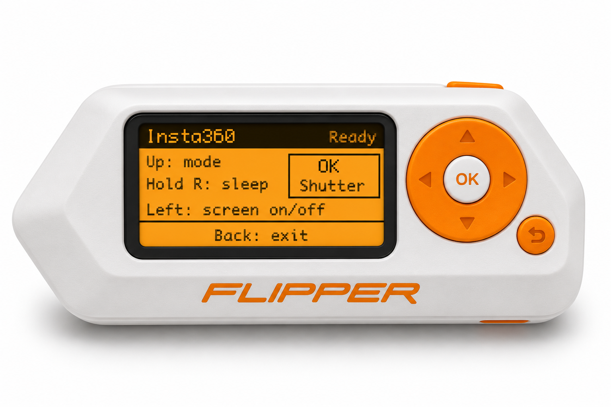

# Insta360 Shutter for Flipper Zero

Control your Insta360 camera from a Flipper Zero over Bluetooth: take photos, start and stop video, change modes, toggle the screen or put the camera to sleep. Press **OK** for the shutter, **Up** to change mode, **Left** for screen on/off or **hold Right** for sleep.

I tested photo capture and video start/stop on my GO 3S with the firmware patch in this repo. Mode change, screen toggle and sleep also worked on my camera in testing on 9 November 2026. See [compatibility](#compatibility) for the test scope.



*AI-generated hardware mockup with an emulated app screen. [Standalone screen preview](docs/images/screen-preview.svg).*

## Compatibility

| Setup | Result |
| --- | --- |
| Flipper Zero f7 with patched firmware 1.5.1 and a GO 3S | Discovery, connection, photo capture and video start/stop verified |
| Stock Flipper Zero firmware 1.5.1 and a GO 3S | The camera skipped the app during discovery |
| Additional controls tested on 9 November 2026 | GO 3S: one-press mode change, screen toggle and sleep confirmed; camera firmware not recorded |
| Other firmware versions or camera models | Untested |

### Potential compatibility with other cameras

Insta360 lists the following cameras as compatible with its [GPS Action Remote](https://store.insta360.com/in/product/gps-action-remote) (checked 8 November 2026):

| Camera family | Models |
| --- | --- |
| X series | X4 Air, X5, X4, X3 and ONE X2 |
| GO series | GO 3S and GO 3 |
| Ace series | Ace Pro 2, Ace Pro and Ace |
| Modular cameras | ONE RS (Twin/4K), ONE RS 1-Inch 360 Edition and ONE R |

These models are potentially compatible with this app's shutter control based on GPS Action Remote support. **Only the GO 3S is hardware verified with this app. All other listed models are untested.** Official remote support doesn't guarantee that a camera accepts this app's pairing behavior and shutter commands. GPS, wake-up and other official remote features aren't implemented or verified by this app. The GPS Smart Remote and GPS Preview Remote are separate products with different compatibility lists.

### GO 3S pairing requirement

**An Action Pod is required for initial pairing.** The GO 3S uses the Action Pod's touchscreen to open **Bluetooth Remote** and select the Flipper. The GO 3S Retro Bundle ships without an Action Pod, so the camera and Retro Viewfinder alone can't complete these pairing steps. Insta360 confirms that the Retro camera can pair with a separately available GO 3S Action Pod. [Bluetooth Remote instructions](https://onlinemanual.insta360.com/gpsactionremote/en-us/troubleshooting/connect-problem) · [Retro Bundle details](https://onlinemanual.insta360.com/go3s/en-us/operating-tutorials/accessories-kit/retro-bundle/retro-bundle-intro)

## Why the firmware patch is needed

The Stock Firmware doesn't allow an advertising name > 16 characters required to advertise the name `Insta360 GPS Remote`. The GO 3S didn't list the app attempt to advertise a shortened name on stock firmware 1.5.1. Stock firmware limits the app's advertised name to 16 characters and labels the advertised `CE80` UUID list as incomplete. The app can host the remote's Bluetooth service on stock firmware, but it can't change those two parts of the advertisement.

The [firmware patch](firmware/README.md) advertises the full `Insta360 GPS Remote` name and puts `CE80` in a complete 16-bit service list. With both changes in place, the GO 3S discovered the Flipper, connected and responded to the shutter button. We tested the changes together, so we haven't isolated which one the camera requires.

## Installation

Install the patched firmware first, then install the app. The firmware patch is required for the verified GO 3S setup. Installing the app alone on stock 1.5.1 doesn't let the camera discover the Flipper.

### 1. Build and install the patched firmware

The patch targets **Flipper Zero firmware 1.5.1**. Follow the [firmware build and installation instructions](firmware/README.md) to:

1. Back up the Flipper's internal storage and microSD contents. All your content should be retained with this patched update, but back up just in case.
2. Apply the patch to the specified 1.5.1 source revision and build the update package.
3. Copy the generated update directory to the microSD card and install it through the normal updater.
4. Let the Flipper reboot before installing the app.

Other firmware releases or forks may need an adapted patch and their own hardware test.

### 2. Build and install the app

With the patched firmware installed:

1. Install [uFBT](https://github.com/flipperdevices/flipperzero-ufbt) using its installation instructions. Open a terminal in this repository's root, the directory containing `application.fam`. Select the pinned f7 SDK for firmware 1.5.1 (API 88.2), then build:

   ```sh
   ufbt update --hw-target f7 --url https://update.flipperzero.one/builds/firmware/1.5.1/flipper-z-f7-sdk-1.5.1.zip
   ufbt
   ```

   The installable app is generated at **`dist/insta360_remote.fap` inside this repository**. The filename uses an underscore, not a plus sign. uFBT also generates `dist/debug/insta360_remote_d.elf` for debugging; you don't copy that file to the Flipper. Build output is ignored by Git.

2. Install the app using either method:

   - **qFlipper:** connect the Flipper over USB, open the file manager and copy `dist/insta360_remote.fap` to **SD Card → apps → Bluetooth** (`/ext/apps/Bluetooth/insta360_remote.fap`). Replace the existing file when updating. Then open **Apps → Bluetooth → Insta360 Shutter** on the Flipper.
   - **USB from the terminal:** close qFlipper so it releases the USB connection, exit the running app on the Flipper with Back and run `ufbt launch` from this repository's root. This builds, uploads and launches the app. If it says the app must be closed manually, press Back on the Flipper and run the command again.

   Keep the filename `insta360_remote.fap` when updating. An older copy named `insta360_shutter.fap` can appear as a second **Insta360 Shutter** menu entry; remove that older copy if present.

3. Follow [Connect and shoot](#connect-and-shoot) to pair the camera and test the controls. Building or installing the `.fap` doesn't install the firmware patch; complete the firmware step first.

## Connect and shoot

1. Power on the GO 3S and Action Pod. Open **Bluetooth Remote** on the Action Pod and select **Insta360 GPS Remote**.
2. Wait for **Ready** on the Flipper. In **Photo** mode, press **OK** to take a photo. In **Video** mode, press **OK** to start recording and press it again to stop. Check the result on the Action Pod.
3. Press **Back** to exit and restore the Flipper's normal Bluetooth profile.

If the remote is missing, scan from nRF Connect on Android. Look for the full name and a **Complete list of 16-bit Service UUIDs** containing `CE80`. Disconnect any scanner that connected to the Flipper before trying again on the camera.

## Controls

| Button | Action |
| --- | --- |
| **OK** | Take a photo in Photo mode or start/stop recording in Video mode |
| **Up** | Cycle to the next camera mode; press again to keep cycling |
| **Left** | Toggle the camera screen on/off |
| **Hold Right** | Put the GO 3S to sleep and disconnect from the remote |
| **Back** | Exit and restore the Flipper's normal Bluetooth profile |

Each press of **Up** advances to the next available camera mode. Press Up again to keep cycling through the modes until you reach the one you want. The app sends mode select followed by confirmation after 300 ms, so you don't need to press OK to confirm. OK continues to work as the shutter in the selected mode. Change modes with recording stopped.

The screen shows **Ready** when the camera has subscribed to remote commands. A “sent” message confirms the Bluetooth update, not the camera's response. Check capture and recording status on the Action Pod.

Shutter, one-press mode change, screen toggle and sleep passed camera testing. **Sleep is one way: the GO 3S disconnects from the Flipper when it goes to sleep and this app can't wake it.** Turn the camera back on manually. Screen on/off works as a toggle without putting the camera to sleep. Wake-up and GPS aren't implemented. Reconnect after manually waking the camera or after a power cycle still needs verification. See the [protocol and hardware notes](docs/protocol-and-testing.md) for packet details and the recorded test scope.

## Licensing

The Flipper app source is available under the [MIT License](LICENSE).
The [firmware patch](firmware/insta360-advertising.patch) modifies Flipper firmware and is covered by [GPLv3](firmware/LICENSE).

## Screen preview

Regenerate the SVG with `python3 scripts/render_screen.py` after changing `remote_screen.h`. The preview uses approximate fonts rather than the firmware fonts. The screen reports connection readiness and commands sent, not camera recording state.
